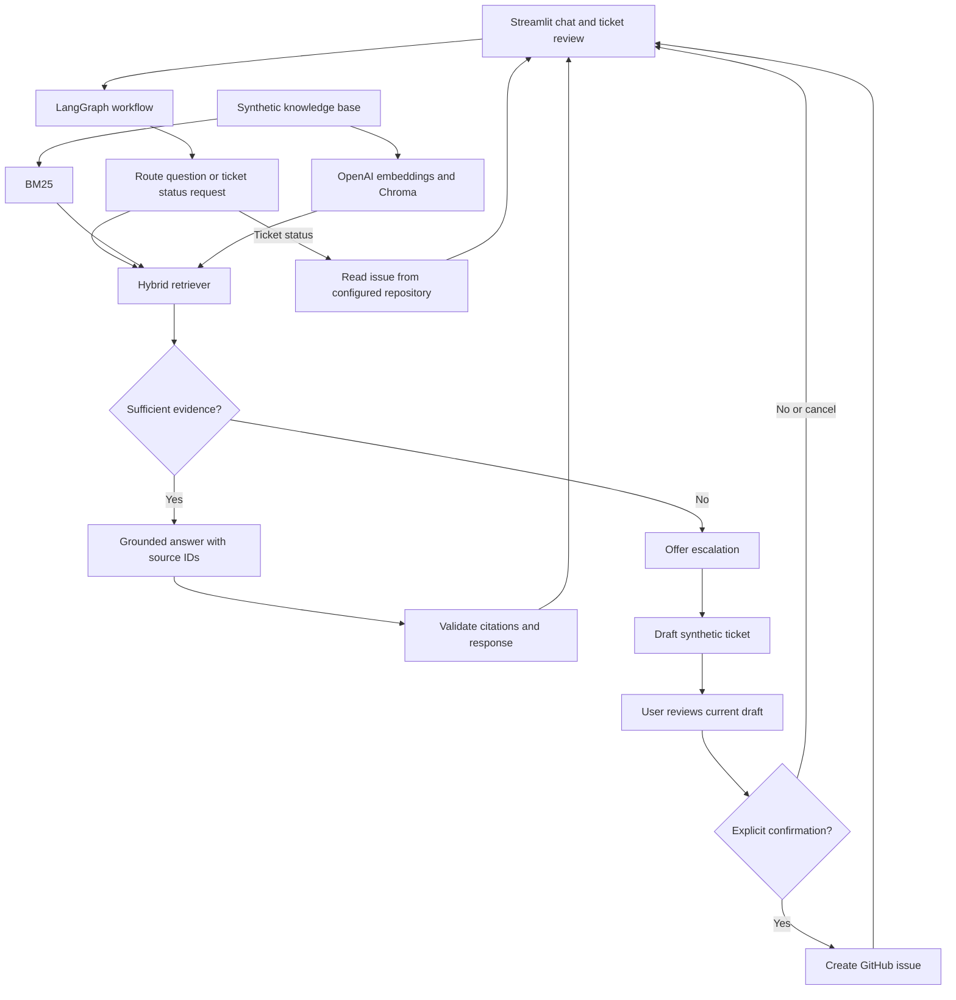

# SmartDesk AI: Project Plan and Session Handoff

Last updated: 2026-10-31

## 1. Purpose of This Document

This is the durable project plan and handoff for a new coding session. Read it before making changes, then verify the actual repository state. Completed checkboxes describe implemented work; unchecked items are planned work, not existing features.

Update this document after each milestone with changed files, verification results, decisions, blockers, and the next concrete task. Never store credentials, private employee information, or raw sensitive conversations here.

## 2. Project Goal

Build a resume-ready IT and HR help-desk assistant that answers employee questions using a fictional company knowledge base, cites its sources, and offers GitHub Issues escalation when it cannot safely answer. Support ticket status lookup and demonstrate the complete workflow in a Streamlit application.

Public repository: https://github.com/ppratik03/smartdesk-ai

Fictional organization: Northstar Works. All policies, employee identities, and ticket examples must be synthetic. This is a capstone demonstration, not a production HR system.

### Core User Journeys

1. Ask an IT, HR, onboarding, or payroll question and receive a grounded answer with sources.
2. Ask a question outside the knowledge base and receive an honest abstention plus an escalation offer.
3. Review and edit a synthetic ticket draft, explicitly confirm submission, and receive its GitHub issue number and link.
4. Request the status of a ticket in the configured repository and receive its current state and relevant public details.
5. Cancel a ticket draft without creating an issue or losing the ability to continue chatting.

### Scope Boundaries

- No real employee data, enterprise authentication, actual payroll actions, or autonomous account/device changes.
- No ticket creation without explicit confirmation of the current draft.
- No claims that retrieval scores are calibrated probabilities.
- No production privacy, availability, or compliance claims.
- Deployment, authentication, analytics dashboards, and multi-company support are optional extensions after the core demo works.

## 3. Environment and Existing Stack

Workspace: `C:\Users\patelp\source\Pratik\python\IK\Capstone\SmartDesk-AI`

| Area | Current Choice |
| --- | --- |
| OS and shell | Windows, PowerShell |
| Local Python | 3.13.3 in `.venv`, previously selected in VS Code |
| Declared Python support | >=3.11; not yet evidence of testing every supported version |
| Packaging | setuptools, `src/` layout, editable installation |
| UI | Live-only Streamlit chat/review/status app with per-session graph and deferred OpenAI initialization |
| Workflow orchestration | LangGraph, dependency installed; graph not implemented |
| LLM and embeddings | LangChain OpenAI; configured chat model with structured evidence selection |
| Dense retrieval | OpenAI `text-embedding-3-small` and persistent Chroma |
| Sparse retrieval | BM25 via `rank-bm25` |
| Validation | Pydantic |
| Ticket backend | GitHub Issues via Requests; not implemented |
| Configuration | python-dotenv; validated settings and safe readiness check implemented |
| Developer checks | pytest and Ruff |

Dependency ranges currently live in `pyproject.toml`. Record installed versions or introduce a reproducibility mechanism before the final demo, without unnecessary dependency upgrades.

## 4. Verified Implementation Snapshot

### Existing Files

| File | Responsibility |
| --- | --- |
| `README.md` | Setup, retrieval explanation, synthetic-data warning |
| `pyproject.toml` | Dependencies, package discovery, pytest and Ruff settings |
| `.gitignore` | Ignores local environment, secrets, and reference PDFs |
| `.env.example` | Placeholder OpenAI/GitHub settings and Chroma directory |
| `data/knowledge_base.json` | 39 fictional Q&A entries |
| `src/smartdesk/__init__.py` | Package initialization |
| `src/smartdesk/retrieval.py` | Knowledge validation, Chroma factory, hybrid retrieval |
| `src/smartdesk/config.py` | Local settings loading, validation, hidden secret fields |
| `src/smartdesk/check_retrieval.py` | Offline readiness and opt-in live smoke command |
| `tests/test_retrieval.py` | Offline retrieval, default-path, and index lifecycle tests |
| `tests/test_config.py` | Offline configuration and dotenv tests |
| `data/evaluation_queries.json` | 48 labeled synthetic development/test queries |
| `src/smartdesk/evaluation.py` | Dataset validation and dense/BM25/hybrid baseline CLI |
| `src/smartdesk/answers.py` | Structured evidence selection, validated excerpts, safe fallbacks |
| `tests/test_evaluation.py` | Dataset and metric regressions |
| `tests/test_answers.py` | Grounding, abstention, invalid-output, and failure regressions |
| `src/smartdesk/tickets.py` | Repository-scoped GitHub client, immutable drafts, confirmation guards, preview/status CLI |
| `tests/test_tickets.py` | Mocked creation, cancellation, status, stale approval, and uncertain-outcome regressions |
| `src/smartdesk/workflow.py` | Typed LangGraph routes, in-memory checkpoints, review interrupts, and retained ticket workflows |
| `tests/test_workflow.py` | Offline graph journeys, edit/approval guards, cancellation, and replay tests |
| `app.py` | Live-only Streamlit chat/citations, guarded review/edit/confirm/cancel, and GitHub status |
| `tests/test_app.py` | 34 network-free UI/workflow cases using mocked live services, with session/rerun guards and initialization checks |
| `.streamlit/config.toml` | Consistent light theme |
| `assets/smartdesk-mark.svg` | Small help-desk brand mark |
| `docs/EVALUATION_REPORT.md` | Measured baseline and live answer smoke results |
| `CAPSTONE_PLAN.md` | This plan and session handoff |

### Completed Work

- [x] Initialize repository and isolated Python environment.
- [x] Install application and developer dependencies; earlier import and dependency checks passed.
- [x] Build synthetic knowledge entries across IT, HR, Onboarding, and Payroll.
- [x] Keep each question and its complete answer as one retrieval unit.
- [x] Validate knowledge entries with Pydantic and reject duplicate IDs or an empty knowledge base.
- [x] Implement injectable dense search and normalized BM25 fusion.
- [x] Implement preliminary answerability thresholds.
- [x] Add offline tests for ranking, sparse evidence, abstention, and blank input.
- [x] Add setup and secret-handling documentation.
- [x] Verify default knowledge-base loading without changing its correct path.
- [x] Ignore `.data/` and verify local secrets/index data are untracked.
- [x] Load validated settings from `.env` without displaying secret values.
- [x] Reuse content-versioned Chroma indexes and resume partial builds without deleting old vectors.
- [x] Run real OpenAI/Chroma smoke checks with three synthetic queries.
- [x] Build a fixed 48-query dataset and measure development/test retrieval baselines.
- [x] Implement model-selected evidence with source/quote validation and exact-excerpt rendering.
- [x] Run live answer checks for supported policies, unknown values, and an instruction override.
- [x] Implement repository-scoped ticket creation/status with draft-bound confirmation and cancellation.
- [x] Prevent repeated submissions on retained workflow instances and lock uncertain outcomes against retries.
- [x] Test GitHub behavior with mocked HTTP calls and smoke-test offline ticket preview.
- [x] Add typed LangGraph orchestration with explicit routing and review interrupts.
- [x] Test graph answer/escalation, edit/confirm/cancel, status, and failed/uncertain write replay paths.
- [x] Add session-retained Streamlit chat, sources, review/edit/confirm/cancel, and status.
- [x] Verify offline UI journeys with AppTest and desktop/mobile browser checks.

### Retrieval Contract

`KnowledgeEntry` contains `id`, `domain`, `category`, `question`, `answer`, and `keywords`.

`SearchResult` contains the entry, dense score, sparse score, combined `confidence`, and `answerable` flag.

Current defaults:

```text
combined score = 0.60 * dense score + 0.40 * normalized BM25 score
answerable = dense score >= 0.35 AND combined score >= 0.55
top_k = 5
```

BM25 scores are normalized by the largest positive score for the current query. Dense scores are clamped to [0, 1]. These heuristic choices need evaluation against real embedding results. The dense weight was adjusted using a constructed unit-test case, not a representative evaluation dataset.

Monitor flickering and office parking are deliberate knowledge gaps. Preserve them as unsupported examples unless the evaluation plan is intentionally changed.

### Verification History and Limits

- Current checks: 125 network-free pytest tests passed, Ruff passed for `app.py src tests`, and touched UI source/test diagnostics found no errors. Earlier dependency/import checks also passed.
- Offline tests mock dense search, Chroma, embeddings, answer generation, and GitHub HTTP calls. They do not call live APIs.
- Real OpenAI/Chroma smoke checks ran successfully twice. Password reset: dense 0.540, combined 0.724, answerable. Office parking: dense 0.149, combined 0.489, abstained. Monitor flickering: dense 0.000, combined 0.400, abstained.
- The first live run exposed negative default Euclidean relevance scores. An explicit bounded conversion resolved the warnings while preserving positive scores and the observed decisions.
- A second live run reused the versioned index. Mocked tests separately verify unchanged-index reuse, content versioning, and partial-index recovery.
- The live 48-query retrieval baseline is documented in `docs/EVALUATION_REPORT.md`. All three methods ranked 36/36 supported queries correctly; hybrid falsely accepted 3/6 unsupported development queries and 0/6 test queries. No thresholds were tuned.
- Six live answer scenarios checked password reset, numeric sick leave, the three development false accepts, and an instruction override. Supported cases returned verified excerpts; the other four abstained. This is not a full answer safety evaluation.
- GitHub client and confirmation guards are implemented and tested offline. Preview CLI ran without API calls. Live permissions, creation, and status remain unverified; no issues were created.
- LangGraph interrupt/resume behavior is verified against the installed library with 23 offline workflow tests. Graph tests inject model/search stubs and mocked GitHub HTTP calls; no new live requests were made.
- Streamlit runs locally at http://127.0.0.1:8501. Historical desktop (1440px) and mobile (390px) checks used the former demo backend for cited answers, abstention, edit/cancel/confirm, and status. Screenshots and geometry checks verified loaded assets, restored Material icon fonts, no horizontal overflow, and an unclipped mobile logo. These are not live-service journey checks.
- The 34 network-free UI cases use mocked live services and cover AppTest journeys, the 12 capstone examples, low-confidence escalation, deferred and cached initialization, retained status snapshots, isolated clients/sessions, existing live-review migration, discarded old demo workspaces, acknowledgement reset, sanitized configuration failures, and uncertain-write lockout. No OpenAI/GitHub calls or public writes were made. Mocked example results verify wiring, not semantic retrieval or model quality.
- Approved question aliases remain in the knowledge base, dense documents, and BM25 text. The offline application mode and local ticket backend are removed. The vesting entry explains earning rights over time without inventing a personal schedule. Restart after knowledge schema/data changes; Streamlit can retain old imported models and cached resources. Previous live evaluation results describe the earlier KB version; no new paid retrieval run or threshold tuning was performed.
- Last checked branch was `dev`; existing user changes were preserved. Recheck Git state at every session start.
- `.env` is present and readiness checks reported non-placeholder OpenAI and GitHub credentials. Values were not displayed. GitHub permissions have not been tested.

## 5. Known Issues and Immediate Priorities

1. **Calibration and broader safety evaluation remain pending.** A 48-query baseline now exists. Hybrid accepted three unsupported development queries; exact-excerpt answering abstained on those live cases, but relevance and completeness still require evaluation. Expand adversarial/low-overlap questions and tune only on development data, reserving fresh held-out cases.
2. **Packaged knowledge data is unresolved.** Default loading is correct in the source checkout (`parents[2]` is the repository root), now covered by a regression test. The earlier handoff's path diagnosis was incorrect. Do not change it to `parents[3]`. Decide separately how a wheel should include knowledge data.
3. **Old index versions are retained.** Content/model fingerprints prevent destructive rebuilds and allow reuse. Add a deliberate cleanup/force-refresh procedure if needed; do not delete active collections automatically.
4. **Live UI verification and durable recovery remain pending.** The Streamlit app retains `SmartDeskWorkflow` per user session, but browser refresh/new sessions and process restarts can lose it. In-memory checkpoints are not restart reconciliation or multi-process exactly-once GitHub delivery. Uncertain writes stay locked and show the draft UUID for manual reconciliation. Clarification text remains generic. Existing credential readiness is not proof of GitHub permissions.

Recommended next implementation slice: M7 offline CI and reproducibility, followed by broader answer evaluation with fresh held-out data. Live GitHub/UI verification requires explicit approval for public writes. Preserve session-retained graphs and never let the LLM approve a write.

## 6. Target Architecture



Keep retrieval, generation, ticket operations, and orchestration independently testable. The UI should render workflow state, not implement business rules. Use deterministic checks for confirmation and external writes; do not delegate authorization to an LLM.

## 7. Milestone Plan

### M1. Foundation and Offline Retrieval

Status: implemented, with hardening tasks remaining.

- [x] Verify and test default knowledge-base loading; no path fix needed.
- [x] Ignore generated Chroma data.
- [ ] Add focused validation tests for malformed data, duplicate IDs, and invalid retrieval settings where useful.
- [x] Rerun current tests and Ruff using the selected environment.

Acceptance: default loading works from the checkout, offline tests pass without credentials, and generated data/secrets are excluded from Git.

### M2. Configuration, Index Lifecycle, and Live Retrieval

- [x] Add validated settings for keys, repository, chat model, and persistence directory.
- [x] Reject missing or placeholder OpenAI credentials only for live operations; GitHub operation validation remains M4.
- [x] Automatically build/reuse content-versioned indexes and resume partial builds.
- [x] Include knowledge content, schema version, and embedding model in the index fingerprint.
- [x] Report expected API failures without printing credential-bearing exception messages or deleting old indexes.
- [x] Run an opted-in OpenAI/Chroma integration check with synthetic queries.
- [ ] Add explicit force-refresh/old-version cleanup controls if needed.
- [x] Build a labeled retrieval evaluation set and run separate development/test baselines.
- [ ] Calibrate thresholds on development data and evaluate on fresh held-out queries.

Acceptance: restart reuses a valid index, a deliberate rebuild handles knowledge changes, known paraphrases retrieve expected entries, unsupported questions abstain, and measured limitations are documented.

Live calls require a key entered locally by the user and may incur charges. Never ask the user to paste a key into chat. Keep ordinary tests offline.

### M3. Grounded Answer Generation

- [x] Add a generation service consuming selected answerable entries.
- [x] Treat retrieved text as evidence, not executable instructions.
- [x] Render only verified source excerpts and abstain when requested details are missing.
- [x] Return structured answer text and source IDs; validate IDs and quotes against supplied context.
- [x] Include source questions/domains with CLI answers; final UI display remains M6.
- [x] Abstain independently of the retrieval gate; generic clarification fallback exists.
- [ ] Add targeted clarification without ungrounded policy claims.
- [x] Handle model timeouts, malformed output, and invalid citations without fabricated answers.
- [x] Add deterministic tests with a mocked model and an opted-in live smoke check.

Acceptance: supported questions receive faithful, cited answers; unsupported claims and invalid source IDs are not presented as verified facts.

### M4. GitHub Ticket Creation and Status

- [x] Add a repository-scoped GitHub client with request timeouts and bounded error handling.
- [x] Model draft title, synthetic description, and domain; omit optional labels for now.
- [x] Provide offline CLI preview and public-data warning; review UI remains M6.
- [x] Require explicit confirmation tied to the latest draft; edits invalidate earlier confirmation.
- [x] Make cancellation leave GitHub unchanged.
- [x] Reuse successful results on repeated workflow submissions and block ambiguous POST retries.
- [x] Retain workflow instances across Streamlit reruns.
- [ ] Design safe process-restart and lost-session reconciliation.
- [x] Return the issue number and URL only after a verified successful response.
- [x] Read status by a validated issue number from the configured repository only.
- [x] Handle invalid input, not found, permission failures, rate limits, and network errors.
- [x] Test creation/status/cancellation with mocked HTTP calls.
- [ ] Perform a clearly identified synthetic live test only with explicit user approval.

Acceptance: no unconfirmed write is possible, successful submission is traceable, cancellation has no side effect, and ticket lookup cannot target arbitrary repositories.

Use a fine-grained GitHub token limited to this repository with Issues read/write access. Pre-create permitted labels or omit them; do not assume labels already exist. GitHub Issues are the demo ticket backend, not a full ITSM system.

`TicketWorkflow` must be retained rather than recreated on reruns. A failed re-confirmation revokes prior approval. Uncertain writes cannot be retried or edited on the same workflow; check GitHub for the draft UUID marker first. The CLI has preview and read-only status commands only. Synthetic-data acknowledgement is a user responsibility, not automated redaction or sensitive-data detection.

### M5. LangGraph Workflow

- [x] Define typed state for query/route, retrieval, answer/sources, draft, review fingerprint, issue, and errors; keep authorization in the retained ticket workflow. UI chat history remains M6.
- [x] Add nodes for routing, retrieval, grounded answering, escalation offer, draft review, creation, and status lookup.
- [x] Enforce submission guards at the tool boundary as well as in graph routing.
- [x] Bind confirmation to one pending draft and invalidate it when the draft changes.
- [x] Resume checkpointed review without repeating completed external actions on a retained graph instance.
- [x] Wire graph retention across actual UI reruns and verify offline browser journeys in M6.
- [x] Test supported-question, unsupported-question, confirmed-ticket, cancelled-ticket, status, and failure paths.

Acceptance: the graph produces predictable transitions and cannot reach issue creation without validated confirmation. Follow-up questions do not accidentally approve an old draft.

Current API: `ask(query, thread_id)`, `draft_ticket(draft, thread_id)`, `lookup(number, thread_id)`, `review(thread_id, decision)`, and `snapshot(thread_id)`. New actions require unique thread IDs; new input cannot overwrite an existing thread. Review accepts only typed confirm/edit/cancel responses, not natural-language approval. Invalid decisions return to an interrupt; completed, cancelled, failed, or uncertain threads do not repeat external writes. Do not globally cache this stateful graph across users.

### M6. Streamlit Application

- [x] Add the actual chat application as the first screen.
- [x] Keep conversation and pending workflow state in session state.
- [x] Show citations, answer/abstention states, and clear API errors.
- [x] Provide ticket preview/edit/confirm/cancel controls and a status lookup flow.
- [x] Cache safe resources so UI reruns do not rebuild embeddings; verified with mocks.
- [x] Prevent repeated submissions while an operation is in progress; retained graph guards and tests cover reruns.
- [x] Keep retrieval diagnostics out of normal answers; no heuristic scores displayed.
- [x] Verify desktop and mobile layouts and core journeys in the browser using offline demo tickets.
- [ ] Verify live services and GitHub creation/status only with explicit approval for public writes.

Acceptance: a new user can complete each core journey without terminal interaction; no rerun duplicates tickets or embedding builds.

`app.py` is live-only and requires OpenAI configuration. There is no mode selector, local demo ticket backend, or demo fallback. Retrieval/generation resources are globally cached and initialized on the first question, not when opening the screen. Each session retains its own graph/client. GitHub is optional for answers but required for ticket creation/status. Existing live review state is preserved during hot reload; old demo workspaces are not reused. Edits reset acknowledgement; uncertain results offer no retry or Done action. Refresh/restart recovery is not implemented. Network-free UI tests mock live providers and do not establish model quality.

### M7. Evaluation, CI, and Demo Readiness

- [ ] Complete the evaluation strategy below and save sanitized results.
- [ ] Add CI for offline tests and Ruff; no live keys required for ordinary pull requests.
- [ ] Document exact startup, index build, evaluation, and troubleshooting commands once implemented.
- [ ] Verify a clean checkout setup; clarify source-checkout versus packaged-data behavior.
- [ ] Inspect tracked files for secrets, reference PDFs, local indexes, and private artifacts.
- [ ] Create a short demo script, architecture explanation, screenshots, and example synthetic tickets.
- [ ] Write resume bullets using measured results only.
- [ ] Optionally deploy after checking platform persistence, secret handling, and public demo abuse risks.

Acceptance: reproducible setup, passing offline CI, documented live checks and limitations, and a repeatable end-to-end demonstration.

## 8. Evaluation and Test Strategy

### Offline Regression Tests

- Knowledge schema/path handling and unique IDs.
- Hybrid ranking, thresholds, blank input, and low-evidence abstention.
- Generation context boundaries, source validation, and failure fallback.
- Ticket confirmation, cancellation, changed drafts, duplicate prevention, and HTTP failures.
- Workflow routing and state transitions.

Use existing test conventions and dependency injection. Add test files only when a new behavior owner warrants them.

### Labeled Retrieval Evaluation

Create a versioned synthetic dataset with roughly 40-60 queries spanning all four domains. Include exact questions, paraphrases, keyword-heavy queries, near misses, ambiguous questions, and unsupported topics. Label acceptable entry IDs and expected answer/abstain behavior before running evaluation.

Measure top-1 accuracy, recall@k, supported-question answer rate, unsupported-question false-answer rate, and abstention rate. Compare dense-only, BM25-only, and hybrid retrieval on the same dataset. Tune on a development subset; report held-out results separately. Document dataset size and limitations instead of asserting production-level reliability.

### Grounding and Workflow Evaluation

Review answer faithfulness, citation validity, unsupported claims, clarification behavior, and escalation decisions using a written rubric. Include attempts to override grounding or bypass ticket confirmation. Track latency and approximate API usage without recording secrets or unnecessary conversation data.

### Live Integration Checks

Run embeddings/index reuse, generation, and GitHub checks separately from unit tests. Require explicit opt-in and local credentials. Live ticket checks must use synthetic content and user-approved writes. Record which checks actually ran and which were skipped.

## 9. Suggested Module Boundaries

Configuration, retrieval, evaluation, answers, tickets, and orchestration exist; UI remains proposed. Reuse nearby abstractions where practical.

| Proposed Module | Responsibility |
| --- | --- |
| `src/smartdesk/config.py` | Validated settings and local environment loading |
| Existing `src/smartdesk/retrieval.py` | Retrieval contracts and ranking; index lifecycle may remain here initially |
| `src/smartdesk/answers.py` | Grounded generation and citation validation |
| `src/smartdesk/tickets.py` | GitHub client and ticket models/guards |
| `src/smartdesk/workflow.py` | Typed LangGraph state and transitions |
| `app.py` | Streamlit entry point |
| `data/evaluation_queries.json` | Labeled synthetic evaluation queries |

Do not create all modules upfront. Implement one testable milestone at a time and avoid wrappers that add no useful boundary.

## 10. Security and Operational Rules

- Never read or expose `api_keys.txt`, real `.env` contents, tokens, or private reference documents just to gather context.
- Keep `.env.example` placeholders only. Do not hard-code tokens or send them to an LLM.
- Public tickets contain synthetic information only. Minimize ticket content rather than copying entire chats.
- Validate configured repository and issue-number input before API calls.
- Keep secrets out of logs, exceptions, screenshots, saved evaluation files, and this handoff.
- Treat employee input and retrieved documents as untrusted content.
- Use deterministic authorization for all external writes; conversational intent alone is insufficient.
- Add timeouts and bounded retries for safe reads. Handle uncertain write outcomes explicitly.
- Preserve unrelated user changes. Do not commit, push, change branches, or clean the worktree without user authorization.

## 11. Current Commands

Run from the repository root in PowerShell. These commands are already supported by the existing project:

```powershell
.\.venv\Scripts\python.exe -m pip install -e ".[dev]"
.\.venv\Scripts\python.exe -m pytest -q
.\.venv\Scripts\ruff.exe check app.py src tests
.\.venv\Scripts\python.exe -m streamlit run app.py --server.address 127.0.0.1 --server.port 8501 --browser.gatherUsageStats false
.\.venv\Scripts\python.exe -m smartdesk.check_retrieval
.\.venv\Scripts\python.exe -m smartdesk.check_retrieval --live
.\.venv\Scripts\python.exe -m smartdesk.evaluation
.\.venv\Scripts\python.exe -m smartdesk.evaluation --live
.\.venv\Scripts\python.exe -m smartdesk.answers "How do I reset my company password?" --live
.\.venv\Scripts\python.exe -m smartdesk.tickets preview --title "Synthetic monitor problem" --description "A fictional monitor flickers." --domain IT
.\.venv\Scripts\python.exe -m smartdesk.tickets status 12 --live
git status --short --branch
git check-ignore .env api_keys.txt .data/chroma
```

Create `.env` from `.env.example` only if it does not already exist; never overwrite existing local credentials. OpenAI commands using `--live` may incur API charges and build or reuse the local index. The ticket preview requires no token and makes no API calls. Ticket status is read-only, requires a GitHub token with repository access, and `12` must be replaced with an existing issue number. No CLI command creates issues. The app is live-only, requires an OpenAI key, and initializes paid retrieval resources on the first question. Public GitHub writes still require explicit draft confirmation. Use another port if 8501 is occupied; restart after changing cached live configuration.

For a coding-agent session, configure the selected Python environment and obtain its executable details through available environment tools before running Python commands. Check diagnostics against the correct workspace path.

## 12. Demo Outline and Final Deliverables

1. Show the fictional knowledge base and explain why complete Q&A pairs are retrieved.
2. Ask a supported IT question and show the grounded answer and citations.
3. Ask a supported HR or payroll paraphrase to demonstrate semantic retrieval.
4. Ask about office parking or monitor flickering and show abstention.
5. Review a synthetic escalation draft, cancel once, then explicitly confirm a new submission.
6. Open the created GitHub issue and query its status in the application.
7. Summarize measured retrieval results, safety controls, limitations, and next improvements.

Final artifacts: working repository, setup README, architecture diagram, test suite and CI, synthetic knowledge/evaluation data, sanitized evaluation report, demo screenshots or recording, and evidence-backed resume bullets. Do not invent performance percentages.

## 13. New-Session Resume Prompt

Paste this into a new session or ask the agent to read this file:

```text
Continue the SmartDesk AI capstone. Read CAPSTONE_PLAN.md and README.md, then
inspect the actual repository state and relevant local instructions. Preserve
all existing user changes. Implement the next incomplete milestone in small,
tested slices and update CAPSTONE_PLAN.md with results and remaining work.

Current priority: M7 offline CI/reproducibility and broader answer evaluation with
fresh held-out cases. Streamlit chat/citations, review/edit/confirm/cancel, status,
and offline browser journeys are implemented. Typed LangGraph review interrupts
reuse the existing answer/ticket contracts. Keep SmartDeskWorkflow
per user session across reruns, not in a shared global cache. New actions need new
thread IDs; snapshot renders state without executing it. Restart recovery is pending.
No live GitHub operations have been performed and no public issues were created.
Configuration, index reuse, a 48-query retrieval baseline, and exact-excerpt
grounded answer generation exist. Read docs/EVALUATION_REPORT.md for limitations.
The default knowledge path is correct and regression-tested; do not apply the
old handoff's incorrect parents[3] suggestion. 125 network-free tests pass, including
34 UI/workflow cases. The app is live-only: no offline selector or local demo backend.
OpenAI configuration is required; retrieval initializes on the first question.
Live-resource reuse, examples, and ticket journeys are tested with mocks, not live
model-quality or GitHub verification. Browser refresh/new sessions lose
retained state; uncertain writes must be reconciled manually before retrying.
Retrieval falsely accepts some unknown personal values; the six live answer
smoke checks do not prove broad safety. Calibration and fresh held-out testing
remain pending; do not optimize repeatedly against the inspected test split.

Use synthetic data only. Never read or print secrets. Do not create GitHub issues
without explicit user confirmation, and do not commit or push unless asked.
Distinguish proposed features from implemented behavior and report any live
checks that remain blocked on locally supplied credentials.
```

## 14. Handoff Ledger

| Date | Change | Verification | Next Task |
| --- | --- | --- | --- |
| Before 2026-10-31 handoff | Repository/environment, synthetic KB, hybrid retrieval, six tests | Previously recorded: six tests passed; Ruff and import/dependency checks passed; no live integrations | Default-path regression and index/config hardening |
| 2026-10-31 | Created this project plan from current files and prior session summary; no application changes | Documentation checks only; executable checks not rerun for this documentation-only task | Begin M1 hardening, then M2 |
| 2026-10-31 | Corrected handoff path diagnosis; added default-path test, data ignore rule, settings, versioned index reuse, bounded relevance, and check command | 14 offline tests and Ruff passed; correct-path source diagnostics clean; three synthetic live queries passed twice; secrets/index ignored and untracked; no tickets created | Labeled retrieval evaluation, then grounded generation |
| 2026-10-31 | Added 48-query baseline, sanitized evaluation report, structured evidence-selected answers, and answer CLI | 28 offline tests and Ruff passed; new-module diagnostics clear; live retrieval baseline and six answer smoke checks completed; thresholds unchanged; no GitHub writes | Draft-bound ticket confirmation/client, plus broader evaluation hardening |
| 2026-10-31 | Added repository-scoped ticket client, immutable drafts, confirmation/cancellation guards, uncertain-write locks, and preview/status CLI | 68 offline tests and Ruff passed; ticket diagnostics clear; offline preview succeeded; no live GitHub requests or writes | Typed LangGraph orchestration, then Streamlit; retain workflow state and plan restart reconciliation |
| 2026-10-31 | Added typed LangGraph routes, in-memory checkpoints, review interrupts, retained ticket workflows, and per-instance execution lock | 91 offline tests and Ruff passed; workflow diagnostics clear; 23 graph tests exercised interrupt/resume and replay guards; no live requests or public writes | Streamlit chat/review/status UI with per-session graph retention and browser validation |
| 2026-10-31 | Added Streamlit chat/citations, guarded ticket review/edit/confirm/cancel, status, session retention, cached live resources, offline demo, and light theme | 104 offline tests and Ruff passed; 13 AppTest cases; UI diagnostics clear; 1440px/390px browser journeys and screenshots verified; no OpenAI/GitHub requests or public writes | M7 offline CI/reproducibility, fresh answer evaluation, and separately approved live verification; lost-session/restart reconciliation pending |
| 2026-10-31 | Fixed offline rejection of capstone example wording with KB-owned question aliases; added general vesting explanation and alias text to live retrieval inputs | 124 offline tests and Ruff passed; all 12 example questions select the correct source; unsupported qualifiers and ambiguous aliases covered; restarted browser renders cited sick-leave answer; no paid APIs or public writes | Existing M7 work; revalidate live retrieval against the updated KB before quality claims; restart after schema/data edits |
| Current session | Removed offline application mode/local demo tickets; live-only session graph, first-question initialization, and safe migration of existing live review state | 125 network-free tests, including 34 UI cases, passed; Ruff and touched diagnostics clean; mocked OpenAI/GitHub boundaries; no paid calls or public writes | M7 CI/reproducibility and fresh evaluation; explicitly approved live GitHub journeys and restart reconciliation remain pending |

At every handoff, replace stale priorities in the resume prompt and add a concise ledger entry. Record blockers and skipped checks explicitly so a future session does not mistake planned or historical behavior for current verified behavior.