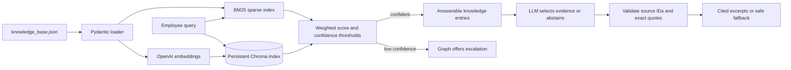

# SmartDesk AI

SmartDesk AI is a browser-based IT and HR help-desk assistant for the fictional Northstar Works organization. Employees can ask questions about IT, HR, onboarding, and payroll, receive answers with cited knowledge-base excerpts, and request human support through GitHub Issues when the assistant cannot answer safely.

This is an agentic AI capstone, not a production HR system. All company policies, employee details, and ticket examples must be synthetic. The application is live-only: it uses OpenAI for retrieval and answer generation, with no local demo fallback.

### What You Can Do

- Ask policy and procedure questions and inspect the cited source excerpts.
- Get an abstention or clarification instead of an unsupported answer.
- Open a synthetic ticket form, review/edit/cancel the draft, and explicitly approve issue creation.
- Look up the status of an existing issue in the configured GitHub repository.

The model cannot authorize a ticket. Creating an issue always requires human confirmation and synthetic-data acknowledgement.

## How It Works

The knowledge base contains 39 question-and-answer entries across IT, HR, onboarding, and payroll. Each Q&A is kept as one retrieval unit so its employee question stays paired with the complete policy answer. Monitor flickering and office parking are deliberate gaps used to test escalation behavior.

Retrieval combines dense search from OpenAI `text-embedding-3-small` embeddings stored in Chroma with sparse BM25 keyword search. The default score is `0.60 * dense + 0.40 * normalized BM25`. A result is answerable only when its dense score is at least `0.35` and its combined score is at least `0.55`. These initial thresholds should be tuned against a larger evaluation set before production use.

| Technology | Role |
| --- | --- |
| Streamlit | Browser chat, ticket forms, citations, and status UI |
| LangGraph | Stateful routing and human-review interrupts |
| OpenAI / LangChain OpenAI | Embeddings and structured evidence selection |
| Chroma / LangChain Chroma | Persistent local vector search |
| rank-bm25 | Keyword retrieval combined with dense search |
| Pydantic / python-dotenv | Validated data contracts and local configuration |
| requests | Repository-scoped GitHub Issues API calls |
| pytest / Ruff | Network-free tests and lint checks |

See [the architecture document](docs/ARCHITECTURE.md) for diagrams and the class/function associated with each task.

## Requirements

- Python **3.11 or newer**. Local development has been verified with Python **3.13.3**; the examples below use Python 3.13.
- A terminal and a browser. The commands below use Windows PowerShell; VS Code is optional.
- Internet access and an OpenAI API key with access to the configured chat model and `text-embedding-3-small`. API usage may incur charges.
- For ticket creation/status: a GitHub account, an accessible repository, and a fine-grained token with repository Issues read/write permission. GitHub configuration is optional for answering questions.
- A writable local directory for the Chroma index, normally `.data/chroma`.

Dependencies are installed from [pyproject.toml](pyproject.toml); you do not need to install each library separately.

## First-Time Setup

### 1. Open the Project Folder

If you do not already have the repository, clone it using Git:

```powershell
git clone https://github.com/ppratik03/smartdesk-ai.git
cd smartdesk-ai
```

If the project is already on your computer, open a terminal in its root folder instead. In VS Code, open the project folder and choose **Terminal > New Terminal**. Run the following commands from that folder.

### 2. Create the Environment and Install Dependencies

Create the environment only if it does not already exist. If you have another supported Python version installed, replace `-3.13` with that version, for example `-3.11`.

```powershell
if (-not (Test-Path .venv\Scripts\python.exe)) {
	py -3.13 -m venv .venv
}
.\.venv\Scripts\python.exe -m pip install -e ".[dev]"
```

The `dev` extra includes pytest and Ruff. These commands use the environment's Python directly, so activation and PowerShell execution-policy changes are not required.

### 3. Configure Local Services

Create the local configuration only if it is missing; never overwrite existing credentials:

```powershell
if (-not (Test-Path .env)) {
	Copy-Item .env.example .env
}
```

Open the local `.env` file in your editor and set the following values:

| Variable | Required for | Value |
| --- | --- | --- |
| `OPENAI_API_KEY` | Opening the app and answering questions | Your OpenAI API key, entered locally |
| `GITHUB_TOKEN` | Creating issues and checking status | Fine-grained token restricted to the chosen repository; leave blank if not using tickets |
| `GITHUB_REPOSITORY` | GitHub operations | `owner/repository`; template default is `ppratik03/smartdesk-ai`, but you can choose your own repository |
| `CHROMA_PERSIST_DIRECTORY` | Local index storage | `.data/chroma` by default |
| `OPENAI_CHAT_MODEL` | Answer generation | `gpt-4o-mini` by default; use a model that supports the structured-output schema |

Replace the `replace_me` placeholders. Never commit credentials or paste them into chat or source files. The target repository determines who can see tickets; issues in this public capstone repository are public. Use synthetic information only, regardless of repository visibility.

### 4. Start the App and Open Your Browser

```powershell
.\.venv\Scripts\python.exe -m streamlit run app.py --server.address 127.0.0.1 --server.port 8501 --browser.gatherUsageStats false
```

Keep the terminal running and open **http://127.0.0.1:8501** in your browser. If the browser does not open automatically, enter that address manually. This starts a local application, not a publicly deployed website.

Press **Ctrl+C** in the terminal to stop the server. If port `8501` is occupied, change `--server.port 8501` to `--server.port 8502` and open **http://127.0.0.1:8502** instead.

## Run Again After Setup

You do not need to recreate the environment or reinstall dependencies for every launch. From the project root, run:

```powershell
.\.venv\Scripts\python.exe -m streamlit run app.py
```

Open the **Local URL** printed in the terminal, normally **http://localhost:8501**. This is equivalent to using the activated environment's `python -m streamlit run app.py` command.

## Try the Main Workflows

1. Ask a question such as "How do I reset my password?" and expand **Sources** to inspect the cited evidence. The first question may take longer while the index initializes and may incur OpenAI charges.
2. Ask about an unsupported topic such as office parking. If the assistant abstains, choose **Draft ticket**, or use **New ticket** to start a ticket directly.
3. Enter a synthetic title, team, and description, then choose **Review draft**. Review does not create an issue.
4. Edit or cancel as needed. Only acknowledge synthetic data and choose **Confirm public issue** when you intend to create a real issue in the configured repository.
5. Use its issue number in **Ticket status** and choose **Check status**. GitHub configuration is required for both ticket creation and status lookup.

## Troubleshooting

| Problem | What to check |
| --- | --- |
| Browser cannot connect | Start Streamlit first, keep its terminal running, and use the exact local URL/port printed there |
| `py` or the requested Python version is not found | Install Python 3.11+ or select an installed supported version; `py -0p` lists interpreters for the Windows launcher |
| Virtual-environment Python is missing | Complete environment creation from the project root |
| `No module named streamlit` or `smartdesk` | Run the dependency-install command using the same virtual-environment Python used to start the app |
| Services could not be initialized | Check local OpenAI configuration; `replace_me` is not a valid credential |
| Retrieval or answer generation fails | Check internet access, API account access/usage limits, and availability of the configured models |
| GitHub tickets are not configured or access is denied | Check token configuration, selected repository access, and Issues permissions |
| Draft ticket is disabled | Discard the open form or finish/dismiss the active review/result; uncertain writes must be reconciled manually |
| Changes to configuration or knowledge do not appear | Stop and restart Streamlit; resources and imported models can remain cached |

Do not refresh/restart to retry an uncertain issue submission. First inspect GitHub for the displayed draft UUID marker to avoid duplicate issues.

## Streamlit App Details

The app is live-only: chat uses OpenAI-backed hybrid retrieval and grounded answer generation, and tickets use GitHub Issues. There is no offline selector, local demo ticket backend, or demo fallback. The first screen provides chat, source excerpts, synthetic ticket drafts, review/edit/confirm/cancel controls, and issue status. A configured `OPENAI_API_KEY` is required; opening the screen does not initialize embeddings or call OpenAI.

After an unsupported answer, **Draft ticket** opens a blank form with Title, Team, and Synthetic description. Chat text is not copied automatically. **Review draft** prepares the confirmation screen; it does not create an issue. Draft actions are disabled while a form, review, or result is active. Discard a form or dismiss a completed/cancelled result with **Done** before starting another draft. An uncertain write remains locked for manual reconciliation.

Question aliases live in the knowledge base and are also included in dense-search documents and BM25 text. Restart the server after changing the knowledge schema or data so retained workflows and cached live resources load the changes. Live initialization may build a new versioned embedding index and incur charges. Retrieval thresholds are unchanged; previous evaluation results describe the earlier knowledge-base version and need revalidation before quality claims.

The first question builds or reuses the Chroma index and initializes the cached OpenAI resources. Index initialization and questions may incur API charges. Tickets use only `GITHUB_REPOSITORY` and require a configured token; missing GitHub configuration does not prevent answers. Creating a public issue requires reviewing its current draft, acknowledging synthetic data, and clicking **Confirm public issue**. Read-only status requests also use the configured repository.

Each session retains its own graph, chat history, ticket workflows, and status snapshots. Only the stateless live retrieval/generation resources are globally cached; reruns do not rebuild them or replay completed work. Edits reset acknowledgement. Unknown write outcomes disable new tickets and submission controls and display the draft ID for manual GitHub reconciliation.

Session state is not durable storage. Refreshing the browser, reconnecting into a new session, or restarting the server can lose the retained workflow. Do not do this to retry an uncertain write; first check GitHub for its draft UUID marker. Automated restart reconciliation and multi-process exactly-once delivery remain unimplemented. Configuration changes to cached live resources require a server restart.

The UI test module has 34 network-free cases with mocked live services: AppTest journeys, all 12 capstone example questions, low-confidence escalation, deferred initialization, cached-resource reuse, session isolation, live-state migration, and ticket safety guards. Mocked search results and answer excerpts test orchestration, not live retrieval/model quality. Earlier desktop/mobile journey checks used the former demo backend. Live GitHub permissions, status, and creation have not been verified. The full network-free suite currently has 125 passing tests.

## Validation

```powershell
.\.venv\Scripts\python.exe -m pytest -q
.\.venv\Scripts\python.exe -m ruff check app.py src tests
```

The standalone CLI examples below use `python`; if your environment is not activated, replace it with `.\.venv\Scripts\python.exe` as in the commands above.

The retrieval tests use a deterministic dense-search stub, so they do not call OpenAI. The actual Chroma index uses the OpenAI key when initialized.

Check local settings without printing secrets or making API calls:

```powershell
python -m smartdesk.check_retrieval
```

Build or reuse the Chroma index and run three synthetic queries with real embeddings:

```powershell
python -m smartdesk.check_retrieval --live
```

The live check incurs OpenAI API usage. It does not create GitHub issues. Settings load from the repository-root `.env`, with existing environment variables taking precedence. Relative persistence paths resolve against the repository root, not the working directory.

Chroma collections are versioned by knowledge content and embedding model. Unchanged knowledge reuses existing vectors; changed knowledge gets a separate collection, preserving the previous index. Partial indexes add only missing entries. Old versions are retained locally in ignored `.data/` and may need deliberate cleanup later. Relevance scores use a bounded Euclidean conversion; thresholds remain provisional.

The initial live smoke check answered password reset and abstained on office parking and monitor flickering. This is integration evidence, not a representative retrieval evaluation.

## Evaluation and Answers

Validate the 48-query synthetic dataset without API calls, or run the three-method retrieval baseline:

```powershell
python -m smartdesk.evaluation
python -m smartdesk.evaluation --live
```

Live evaluation writes per-query results to ignored `.data/evaluation_report.json`. See [the evaluation report](docs/EVALUATION_REPORT.md) for measured results and limitations. Thresholds remain provisional: hybrid retrieval incorrectly accepts some requests for unknown personal values.

Ask a synthetic question with live retrieval and grounded evidence selection:

```powershell
python -m smartdesk.answers "How do I reset my company password?" --live
```

The model selects source excerpts or abstains. Source IDs and exact quotes are validated against supplied knowledge answers; only verified excerpts are rendered. Unknown personal facts must not be substituted with related procedures. Responses include status, answer text, and source question/domain metadata. Invalid evidence fails closed. Source validation does not prove semantic relevance, and the current clarification message is generic.

Without `--live`, both commands make no API calls. Live commands incur OpenAI usage and never create GitHub issues. The answer command remains a standalone CLI integration surface; the Streamlit app uses the graph.

## Tickets

Preview a synthetic ticket without API calls or a GitHub token:

```powershell
python -m smartdesk.tickets preview --title "Synthetic monitor problem" --description "A fictional monitor flickers." --domain IT
```

Read an existing issue from `GITHUB_REPOSITORY` (replace `12` with its issue number):

```powershell
python -m smartdesk.tickets status 12 --live
```

Without `--live`, status makes no API calls. Lookup accepts only a positive issue number, cannot target another repository, and rejects pull requests. Responses include state, URL, labels, and update time. API errors are sanitized; requests have timeouts and do not follow redirects.

The ticket backend exposes immutable `TicketDraft`, `TicketConfirmation`, and `TicketWorkflow` contracts. Creation requires explicit approval and synthetic-data acknowledgement tied to the exact draft and repository. Editing revokes approval, cancellation makes no write, and repeated submission on the same workflow returns the previously created issue. Optional labels are omitted rather than assuming they exist.

Network failures, server errors, or unverifiable successful writes lock that workflow against resubmission. Check GitHub for the draft ID included in its body before considering another submission. The UI retains workflow state across reruns, but process-restart reconciliation is not implemented. Synthetic-data acknowledgement is not an automatic sensitive-data detector.

The CLI deliberately has no creation command; confirmed writes are exposed through the review UI. GitHub behavior is covered with mocked HTTP tests, not live permission or creation checks.

## LangGraph Workflow

[The orchestration service](src/smartdesk/workflow.py) connects retrieval, grounded answers, escalation offers, draft review, confirmed creation, and read-only status lookup through a typed LangGraph state graph. Search, answer generation, and the optional GitHub client are injected, so the graph can be tested without live services.

`SmartDeskWorkflow.ask` handles questions; unsupported answers only offer escalation. `draft_ticket` starts review of an explicit synthetic draft, and `lookup` accepts a positive issue number. Routing is explicit: model output and ordinary chat text never become ticket approval.

Draft review pauses at a LangGraph interrupt. `review` resumes with a typed `confirm`, `edit`, or `cancel` decision. Confirmation requires the preview fingerprint, explicit approval, and synthetic-data acknowledgement. Edits return to review with a new fingerprint; stale or malformed decisions cannot create issues. Edited draft identities remain bound to their original workflow.

Each new action needs a unique thread ID. `snapshot` reads checkpointed state without rerunning work, and repeated review calls on a completed thread return its existing result. Reusing a pending thread for a chat question is rejected. Confirmed writes still pass through the ticket client's independent guard.

Keep one `SmartDeskWorkflow` instance in each user's session, not a global shared cache. Its in-memory checkpoints, retained ticket workflows, and per-instance lock support safe sequential resume in the running process, not durable restart recovery or multi-process exactly-once delivery. The existing CLIs remain standalone integration checks; [app.py](app.py) is the graph's interactive entry point.

## Current Architecture



The Streamlit app uses the ticket backend and LangGraph orchestration without moving authorization into UI or model text. Evaluation hardening, offline CI, reproducibility, and explicitly approved live verification remain.