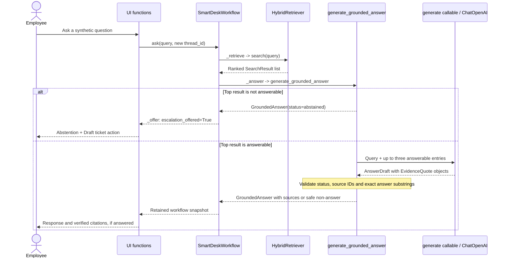

# SmartDesk AI Architecture

This document describes the implemented live-only application. Class names are
shown where classes exist; module-level functions and returned callables are
identified explicitly. External library classes are not application-owned classes.

## Component Design

Arrows show component dependencies and data flow, not concurrent execution.

```mermaid
flowchart TB
    Employee["Employee"] <--> UI["Streamlit UI functions<br/>main, conversation, compose_ticket<br/>review_ticket, sidebar"]

    subgraph Application["Application and orchestration"]
        Workspace["workspace function<br/>st.session_state<br/>Per-session graph, chat and tickets"]
        Graph["SmartDeskWorkflow<br/>LangGraph StateGraph<br/>Question / ticket / status routing"]
        State["WorkflowState<br/>TypedDict graph state"]
        Checkpoints["MemorySaver<br/>In-memory thread checkpoints"]
        Cache["live_resources function<br/>st.cache_resource<br/>Shared retrieval/generation resources"]
        Settings["Settings + load_settings function<br/>Local environment configuration"]
        UI <--> Graph
        Workspace -.-> UI
        Workspace -.-> Graph
        State -.-> Graph
        Checkpoints -.-> Graph
        Settings -.-> Workspace
        Settings -.-> Cache
    end

    subgraph Retrieval["Knowledge loading and hybrid retrieval"]
        KB[("Synthetic knowledge base JSON")]
        Load["load_knowledge_base function<br/>KnowledgeEntry validation"]
        Index["create_chroma_dense_search function<br/>Content fingerprint + missing-ID indexing"]
        Hybrid["HybridRetriever.search<br/>Rank and gate SearchResult objects"]
        Sparse["BM25Okapi.get_scores<br/>Keyword search"]
        Dense["Returned search callable<br/>Chroma similarity search"]
        Store[("Chroma<br/>Local versioned vector index")]
        Embed["OpenAIEmbeddings<br/>text-embedding-3-small"]
        EmbeddingAPI["OpenAI embeddings API"]
        KB --> Load
        Load --> Index
        Load --> Hybrid
        Cache -.-> Index
        Cache -.-> Hybrid
        Index --> Store
        Index -.-> Embed
        Graph -->|"_retrieve"| Hybrid
        Hybrid --> Sparse
        Hybrid --> Dense
        Dense --> Store
        Store --> Embed
        Embed <--> EmbeddingAPI
    end

    subgraph Answers["Grounded evidence selection"]
        Ground["generate_grounded_answer function<br/>Retrieval gate + evidence validation"]
        Generate["create_answer_generator function<br/>Returned generate callable"]
        Model["ChatOpenAI<br/>Structured AnswerDraft output"]
        ChatAPI["OpenAI chat API"]
        Answer["GroundedAnswer + AnswerSource<br/>Verified excerpts / abstention / clarification / error"]
        Graph -->|"_answer"| Ground
        Hybrid -->|"SearchResult list"| Ground
        Cache -.-> Generate
        Ground -->|"Only when retrieval is answerable"| Generate
        Generate --> Model
        Model <--> ChatAPI
        Generate -->|"AnswerDraft + EvidenceQuote"| Ground
        Ground --> Answer
        Answer --> UI
        Ground -->|"Abstention"| Offer["SmartDeskWorkflow._offer<br/>Escalation offer"]
        Offer --> UI
    end

    subgraph Tickets["Human-controlled GitHub actions"]
        Draft["TicketDraft<br/>Immutable synthetic title, team and description"]
        Review["SmartDeskWorkflow._review<br/>LangGraph interrupt<br/>ReviewDecision validation"]
        TicketState["TicketWorkflow<br/>replace_draft / confirm / cancel / submit"]
        Approval["TicketConfirmation.validate<br/>Approval + synthetic-data acknowledgement<br/>Draft/repository fingerprint binding"]
        Client["GitHubTicketClient<br/>create_issue / get_issue"]
        GitHub["GitHub Issues API<br/>Fixed configured repository"]
        Result["IssueInfo / TicketError / TicketWriteUncertain<br/>ticket_result UI function"]
        UI -->|"compose_ticket: manual blank form"| Draft
        Draft -->|"SmartDeskWorkflow.draft_ticket"| Review
        Review -->|"Preview and human decision"| UI
        UI -->|"review: confirm / edit / cancel"| Review
        Review --> TicketState
        TicketState -->|"confirm and submit validation"| Approval
        Approval -->|"Validated create_issue call only"| Client
        Graph -->|"_lookup: read-only get_issue"| Client
        Client <--> GitHub
        Client --> Result
        Result --> UI
    end
```



## Action-to-Code Mapping

### Application and State

| Action/task | Owning class or function | Responsibility | Source |
| --- | --- | --- | --- |
| Render application | Module function `main()` | Configure page, render chat/forms, dispatch input | [app.py](../app.py) |
| Load local configuration | `load_settings()`; `Settings` | Load environment settings and validate required service credentials | [src/smartdesk/config.py](../src/smartdesk/config.py) |
| Retain user workspace | Module function `workspace()`; `st.session_state` | Own graph, client, messages, pending action and ticket results per session | [app.py](../app.py) |
| Cache live resources | Module function `live_resources()`; `st.cache_resource` | Create shared retrieval/generation resources on the first question | [app.py](../app.py) |
| Start a question | Module function `ask_question()` | Allocate a new thread ID, append chat messages, invoke workflow | [app.py](../app.py) |
| Render chat and escalation action | Module function `conversation()` | Read snapshots; Draft ticket explicitly opens the blank form | [app.py](../app.py) |
| Route graph actions | `SmartDeskWorkflow`; external `StateGraph` | Select question, ticket or status path | [src/smartdesk/workflow.py](../src/smartdesk/workflow.py) |
| Define graph state | `WorkflowState` (`TypedDict`) | Carry query, results, answer, draft, issue and stage | [src/smartdesk/workflow.py](../src/smartdesk/workflow.py) |
| Retain graph checkpoints | External `MemorySaver` | Keep thread checkpoints and review interrupts in memory | [src/smartdesk/workflow.py](../src/smartdesk/workflow.py) |
| Read without executing work | `SmartDeskWorkflow.snapshot()` | Render retained results without replaying retrieval or submission | [src/smartdesk/workflow.py](../src/smartdesk/workflow.py) |
| Guard graph execution | `SmartDeskWorkflow._begin()` and instance `RLock` | Reject reused action thread IDs and serialize instance operations | [src/smartdesk/workflow.py](../src/smartdesk/workflow.py) |

### Retrieval and Answers

| Action/task | Owning class or function | Responsibility | Source |
| --- | --- | --- | --- |
| Load synthetic knowledge | `load_knowledge_base()`; `KnowledgeEntry` | Parse JSON, validate entries and reject duplicate IDs | [src/smartdesk/retrieval.py](../src/smartdesk/retrieval.py) |
| Tokenize keyword text | Module function `tokenize()` | Normalize query and knowledge tokens for BM25 | [src/smartdesk/retrieval.py](../src/smartdesk/retrieval.py) |
| Build/reuse vector index | Module function `create_chroma_dense_search()` | Fingerprint content/model/schema; add only missing entries | [src/smartdesk/retrieval.py](../src/smartdesk/retrieval.py) |
| Embed documents and queries | External `OpenAIEmbeddings` | Call the embeddings API through the Chroma integration | [src/smartdesk/retrieval.py](../src/smartdesk/retrieval.py) |
| Persist/search vectors | External `Chroma`; returned `search()` callable | Store vectors locally and return bounded dense relevance scores | [src/smartdesk/retrieval.py](../src/smartdesk/retrieval.py) |
| Compute keyword relevance | External `BM25Okapi.get_scores()` | Score questions, aliases, answers and keywords | [src/smartdesk/retrieval.py](../src/smartdesk/retrieval.py) |
| Combine, rank and gate evidence | `HybridRetriever.search()`; `SearchResult` | Blend dense/BM25 scores and mark each candidate answerable | [src/smartdesk/retrieval.py](../src/smartdesk/retrieval.py) |
| Retrieve through orchestration | `SmartDeskWorkflow._retrieve()` | Invoke injected search and sanitize expected retrieval failures | [src/smartdesk/workflow.py](../src/smartdesk/workflow.py) |
| Gate model invocation | Module function `generate_grounded_answer()` | Clarify blank input; abstain if top retrieval is not answerable | [src/smartdesk/answers.py](../src/smartdesk/answers.py) |
| Select answer evidence | `create_answer_generator()`; returned `generate()`; external `ChatOpenAI` | Request structured exact excerpts, not invented policy prose | [src/smartdesk/answers.py](../src/smartdesk/answers.py) |
| Validate model response shape | `AnswerDraft`; `EvidenceQuote` | Validate status and evidence fields | [src/smartdesk/answers.py](../src/smartdesk/answers.py) |
| Verify citations and render output | `generate_grounded_answer()`; `GroundedAnswer`; `AnswerSource` | Match source IDs and exact answer substrings; return verified excerpts or safe non-answer | [src/smartdesk/answers.py](../src/smartdesk/answers.py) |
| Offer escalation | `SmartDeskWorkflow._answer()` and `_offer()` | Convert abstention into an escalation offer without creating a draft or issue | [src/smartdesk/workflow.py](../src/smartdesk/workflow.py) |
| Display answers and sources | Module function `show_answer()` | Render response and expandable cited excerpts | [app.py](../app.py) |

### Tickets and Status

| Action/task | Owning class or function | Responsibility | Source |
| --- | --- | --- | --- |
| Open/edit initial ticket form | Module function `compose_ticket()` | Collect blank Title, Team and Synthetic description fields; do not copy chat automatically | [app.py](../app.py) |
| Validate and identify draft | `TicketDraft` | Immutable validated fields and UUID marker | [src/smartdesk/tickets.py](../src/smartdesk/tickets.py) |
| Generate preview/fingerprint | `TicketDraft.preview()` and `fingerprint()` | Bind draft content to configured repository | [src/smartdesk/tickets.py](../src/smartdesk/tickets.py) |
| Begin ticket review | `SmartDeskWorkflow.draft_ticket()` and `_draft_ticket()` | Retain a `TicketWorkflow` and prepare review state; no issue POST | [src/smartdesk/workflow.py](../src/smartdesk/workflow.py) |
| Display preview and approval controls | Module function `review_ticket()` | Show current draft, acknowledgement checkbox and explicit confirm/cancel controls | [app.py](../app.py) |
| Pause/resume for human decision | `SmartDeskWorkflow._review()` and `review()`; `ReviewDecision`; external `interrupt`/`Command` | Validate confirm/edit/cancel decisions and resume the existing thread | [src/smartdesk/workflow.py](../src/smartdesk/workflow.py) |
| Edit reviewed draft | `edit_ticket()`; `TicketWorkflow.replace_draft()` | Replace draft and revoke previous approval; require renewed review | [app.py](../app.py), [src/smartdesk/tickets.py](../src/smartdesk/tickets.py) |
| Authorize submission | `TicketWorkflow.confirm()`; `TicketConfirmation.validate()` | Require explicit approval, synthetic-data acknowledgement and matching fingerprint/repository | [src/smartdesk/tickets.py](../src/smartdesk/tickets.py) |
| Cancel before submission | `TicketWorkflow.cancel()` | Revoke confirmation and mark draft cancelled without a write | [src/smartdesk/tickets.py](../src/smartdesk/tickets.py) |
| Submit once within retained workflow | `SmartDeskWorkflow._submit()`; `TicketWorkflow.submit()` | Revalidate current draft; cache success and lock uncertain outcomes | [src/smartdesk/workflow.py](../src/smartdesk/workflow.py), [src/smartdesk/tickets.py](../src/smartdesk/tickets.py) |
| Create GitHub issue | `GitHubTicketClient.create_issue()` and `_request()` | Validate confirmation and POST only to configured repository; no blind POST retries | [src/smartdesk/tickets.py](../src/smartdesk/tickets.py) |
| Validate issue response | `GitHubTicketClient._parse_issue()`; `IssueInfo` | Validate issue data and repository-scoped GitHub URL | [src/smartdesk/tickets.py](../src/smartdesk/tickets.py) |
| Handle uncertain writes | `TicketWriteUncertain`; `TicketWorkflow`; `ticket_result()` | Retain lock and display draft ID for manual reconciliation; no Done/retry | [src/smartdesk/tickets.py](../src/smartdesk/tickets.py), [app.py](../app.py) |
| Look up issue status | `sidebar()`; `SmartDeskWorkflow.lookup()` and `_lookup()`; `GitHubTicketClient.get_issue()` | Perform repository-scoped read-only GET and retain result snapshot | [app.py](../app.py), [src/smartdesk/workflow.py](../src/smartdesk/workflow.py), [src/smartdesk/tickets.py](../src/smartdesk/tickets.py) |
| Display/dismiss ticket result | Module functions `show_issue()` and `ticket_result()` | Show issue/error/cancellation; Done clears completed active result, not uncertain writes | [app.py](../app.py) |

## Question Flow



Blank input returns clarification without retrieval/model calls. An invalid or
failed model response returns a safe error. A model-selected abstention also
produces an escalation offer; clarification and errors do not automatically do so.

Retrieval defaults: `top_k=5`, dense weight `0.60`, normalized BM25 weight `0.40`.
A candidate is answerable only if dense score is at least `0.35` and combined
score is at least `0.55`. These are heuristic scores, not calibrated probabilities.

## Ticket Approval Flow

```mermaid
sequenceDiagram
    actor Employee
    participant UI as Ticket UI functions
    participant Graph as SmartDeskWorkflow
    participant Draft as TicketDraft
    participant Ticket as TicketWorkflow
    participant Guard as TicketConfirmation
    participant Client as GitHubTicketClient
    participant API as GitHub Issues API
    Employee->>UI: Draft ticket / New ticket
    UI-->>Employee: Blank synthetic ticket form
    Employee->>UI: Fill fields and choose Review draft
    UI->>Draft: Validate title, description and domain
    UI->>Graph: draft_ticket(draft, new thread_id)
    Graph->>Ticket: Retain workflow for draft
    Graph-->>UI: _review interrupt: preview and fingerprint
    alt Employee edits
        UI->>Graph: review(edit decision)
        Graph->>Ticket: replace_draft(edited draft)
        Ticket-->>Graph: Previous approval cleared
        Graph-->>UI: New preview/fingerprint and review interrupt
    else Employee cancels
        UI->>Graph: review(cancel decision)
        Graph->>Ticket: cancel()
        Graph-->>UI: Cancelled result; no POST
    else Employee acknowledges synthetic data and confirms
        UI->>Graph: review(confirm decision + fingerprint)
        Graph->>Ticket: confirm(...)
        Ticket->>Guard: validate(draft, repository)
        Graph->>Ticket: _submit -> submit()
        Ticket->>Guard: Revalidate current confirmation
        Ticket->>Client: create_issue(draft, confirmation)
        Client->>Guard: Validate before HTTP write
        Client->>API: POST issue to configured repository
        API-->>Client: Response or uncertain outcome
        Client-->>Ticket: IssueInfo or TicketError
        Ticket-->>Graph: Submitted / failed / uncertain state
        Graph-->>UI: Result snapshot
    end
```

Edits return to review; they do not proceed directly to submission. Cancelling or
successfully completing a ticket leaves a result screen until Done is selected.
Uncertain outcomes remain locked and require manual GitHub reconciliation using
the draft UUID marker.

## State, Service and Safety Boundaries

| Boundary | Implemented behavior |
| --- | --- |
| Application mode | Live-only; no offline selector, local demo tickets or hidden demo fallback |
| OpenAI usage | Configuration required at startup; cached retrieval/generation initialization deferred until the first question; indexing and questions may incur charges |
| Shared resources | Cached `HybridRetriever`, vector-search callable and answer-generator callable |
| Per-user resources | `SmartDeskWorkflow`, `GitHubTicketClient`, checkpoints, chat history, drafts and status results |
| Local persistence | Versioned Chroma collections under the configured persistence directory, normally `.data/chroma` |
| Human authorization | Model output never authorizes tickets; draft/repository-bound approval and synthetic-data acknowledgement are required |
| GitHub scope | Fixed configured repository; token optional for answering but required for ticket creation/status |
| Reruns | Snapshot reads do not execute actions; retained ticket workflows cache successful submissions and reject unsafe replay |
| Recovery limitation | Browser/session loss or server restart can lose graph/ticket state; no durable restart reconciliation or multi-process exactly-once delivery |
| Answer limitation | Exact excerpts and source checks do not prove semantic relevance or answer completeness |
| Data limitation | Synthetic-data acknowledgement is not automatic redaction; only synthetic information belongs in this public capstone |
| Verification | UI/provider tests use mocks and no live writes; these tests do not establish live model quality or GitHub permissions |

## Supporting Evaluation and CLI Surfaces

These are development tools, not alternate application modes:

- [src/smartdesk/check_retrieval.py](../src/smartdesk/check_retrieval.py): retrieval readiness and explicitly opted-in live smoke checks.
- [src/smartdesk/evaluation.py](../src/smartdesk/evaluation.py): labeled retrieval evaluation and report generation.
- [src/smartdesk/answers.py](../src/smartdesk/answers.py): `main()` exposes explicitly opted-in grounded-answer CLI calls.
- [src/smartdesk/tickets.py](../src/smartdesk/tickets.py): `main()` exposes network-free preview and opted-in read-only status, never issue creation.

See [README.md](../README.md) for setup, [CAPSTONE_PLAN.md](../CAPSTONE_PLAN.md)
for the project handoff, and [docs/EVALUATION_REPORT.md](EVALUATION_REPORT.md)
for historical evaluation results and their limitations.